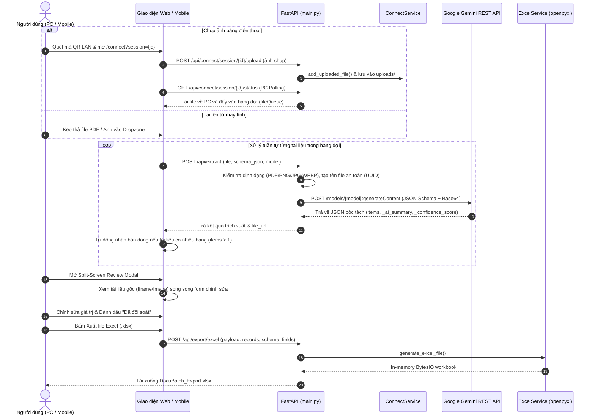

# BÁO CÁO KHỞI TẠO PROJECT INTELLIGENCE — DOCUBATCH AI
**Thời điểm thực hiện**: 2026-11-17  
**Phạm vi**: Toàn bộ codebase dự án `DocuBatch AI` (loại trừ `.env`, `.venv`, `__pycache__`, `uploads`, `build`, `dist`, `.git`).  
**Trạng thái mã nguồn**: Giữ nguyên nguyên bản, không sửa đổi source code trong giai đoạn này.

---

## 1. TỔNG QUAN DỰ ÁN & PROJECT INTELLIGENCE

**DocuBatch AI** là giải pháp phần mềm thông minh hỗ trợ số hóa và bóc tách dữ liệu tài liệu hàng loạt (hóa đơn, chứng từ, hồ sơ địa chính, bìa đất...) sử dụng Trí tuệ nhân tạo Đa phương thức (**Gemini Flash 2.0 / 1.5**). Hệ thống kết hợp khả năng xem xét/đối soát song song (Split-Screen Review), xuất dữ liệu chuẩn hóa sang Excel/JSON và tính năng quét/chụp tài liệu trực tiếp từ điện thoại thông qua mã QR mạng LAN nội bộ.

### Kết quả khởi tạo Project Intelligence:
- **Đã quét và lập chỉ mục hoàn chỉnh**: 48 tệp tin dự án hợp lệ.
- **Sinh chỉ mục tệp**: [`.ai/indexes/FILE_INDEX.json`](file:///d:/Code/DocubatchAI/.ai/indexes/FILE_INDEX.json) (48 files kèm SHA-256, kích thước và vai trò nghiệp vụ).
- **Sinh chỉ mục ký hiệu hàm/lớp bằng Python AST**: [`.ai/indexes/FUNCTION_INDEX.json`](file:///d:/Code/DocubatchAI/.ai/indexes/FUNCTION_INDEX.json) (36 symbols gồm class, async function, method kèm signature, vị trí dòng).
- **Sinh chỉ mục phụ thuộc**: [`.ai/indexes/DEPENDENCY_INDEX.json`](file:///d:/Code/DocubatchAI/.ai/indexes/DEPENDENCY_INDEX.json) (bản đồ import, quan hệ module nội bộ và thư viện bên thứ 3).
- **Cập nhật đồng bộ Project Memory**: [`.ai/memory/PROJECT_CONTEXT.md`](file:///d:/Code/DocubatchAI/.ai/memory/PROJECT_CONTEXT.md), [`.ai/memory/ARCHITECTURE.md`](file:///d:/Code/DocubatchAI/.ai/memory/ARCHITECTURE.md), [`.ai/memory/AI_PIPELINE.md`](file:///d:/Code/DocubatchAI/.ai/memory/AI_PIPELINE.md), [`.ai/memory/API_DOCUMENTATION.md`](file:///d:/Code/DocubatchAI/.ai/memory/API_DOCUMENTATION.md), [`.ai/memory/DECISIONS.md`](file:///d:/Code/DocubatchAI/.ai/memory/DECISIONS.md), [`.ai/memory/CURRENT_TASK.md`](file:///d:/Code/DocubatchAI/.ai/memory/CURRENT_TASK.md).

---

## 2. KẾT QUẢ QUÉT SOURCE CODE & XÁC MINH PROJECT MEMORY

Quá trình quét thực tế đã đối chiếu chi tiết giữa tài liệu khởi tạo ban đầu và mã nguồn thực thi:

| Tiêu chí | Thông tin Memory ban đầu | Thực tế Source Code xác minh | Đánh giá & Điều chỉnh |
|---|---|---|---|
| **AI SDK** | Nghi ngờ dùng `google-generativeai` SDK | Dùng thuần `httpx.AsyncClient` gọi trực tiếp REST API của Google | Tối ưu dung lượng EXE PyInstaller; đã cập nhật memory |
| **API Endpoints** | Chỉ ghi nhận 7 endpoints cơ bản | Thực tế có **12 routes** (trong đó có 5 endpoint phục vụ phiên QR Mobile) | Bổ sung đầy đủ tài liệu API spec cho mobile connect |
| **Batch Processing** | Nghi ngờ backend xử lý batch upload một lần | Frontend (`app.js`) duy trì hàng đợi và gửi tuần tự từng file tới `/api/extract` | Giữ backend stateless, tăng tính ổn định và hiển thị tiến độ thời gian thực |
| **Xử lý Bìa đất** | Chỉ ghi nhận trích xuất tổng quát | Có logic chuyên biệt cho mẫu `land_cover` (cả ở Frontend, Mobile view và Excel styling) | Đã chuẩn hóa mô tả pipeline và service `excel_service.py` |
| **Deployment** | Đắn đo giữa Vercel và Render | Hỗ trợ song song cả hai: `vercel.json` (Vercel) và `render.yaml` (Render) | Ghi nhận rõ cả 2 môi trường deployment |
| **Local / Desktop** | Chạy local thông thường | Hỗ trợ tự dò IP LAN qua socket UDP (8.8.8.8) và cấu hình PyInstaller spec hoàn chỉnh | Ghi nhận đường dẫn tĩnh `_MEIPASS` và cơ chế auto open browser |

---

## 3. PHÂN TÍCH TOÀN BỘ LUỒNG XỬ LÝ TÀI LIỆU (DOCUMENT PIPELINE)



### Đặc điểm nổi bật của Pipeline:
1. **Khả năng bóc tách đa dòng (Multi-row Extraction)**: System instruction và JSON schema định hướng Gemini trích xuất toàn bộ các dòng STT/bảng biểu thành mảng `items`. Phía client sẽ phân rã thành các hàng độc lập `{filename} (dòng 1)`, `{filename} (dòng 2)` giúp đối soát chi tiết từng mục.
2. **Đối soát song song (Split-Screen)**: Hiển thị file gốc qua `iframe` (đối với PDF) hoặc thẻ `` (đối với ảnh chụp) ngay cạnh bảng điền dữ liệu.
3. **Độc lập và bảo toàn**: Tên file gốc của người dùng được bảo tồn để hiển thị trên bảng và file Excel, trong khi file vật lý trên đĩa được sinh UUID định danh tránh trùng lặp.

---

## 4. PHÂN TÍCH GEMINI API & EXCEL EXPORT

### 4.1. Dịch vụ AI (`services/gemini_service.py`)
- **Giao thức**: Sử dụng `httpx.AsyncClient(timeout=90.0)`.
- **Dynamic Model Discovery**: Hàm `get_available_models()` tự động gọi endpoint `https://generativelanguage.googleapis.com/{v1beta|v1}/models?key={api_key}` để lấy danh sách các model thực tế được hỗ trợ bởi API key của người dùng (lọc theo thuộc tính `generateContent`).
- **In-Memory Model Caching**: Kết quả truy vấn model được cache trong biến toàn cục `_CACHED_MODELS[api_key]`.
- **Cơ chế Fallback thông minh**: Khi một model gặp lỗi HTTP 404 (thường xảy ra khi Google đổi tên model hoặc tài khoản chưa kích hoạt), hệ thống tự động fallback lần lượt qua danh sách ưu tiên:
  `gemini-2.0-flash` $\to$ `gemini-2.0-flash-exp` $\to$ `gemini-1.5-flash-latest` $\to$ `gemini-1.5-flash` $\to$ `gemini-1.5-flash-001` $\to$ `gemini-1.5-flash-002` $\to$ `gemini-1.5-pro-latest` $\to$ `gemini-1.5-pro`.
- **Structured Outputs**: Cung cấp `responseSchema` dạng JSON Schema trong `generationConfig` kết hợp `responseMimeType: "application/json"` và `temperature: 0.1` giúp loại bỏ hoàn toàn hiện tượng sinh định dạng markdown dư thừa và đảm bảo tính tất định cao nhất.

### 4.2. Dịch vụ Xuất Excel (`services/excel_service.py`)
- **Thư viện**: `openpyxl`.
- **Tùy biến cấu trúc cột theo ngữ cảnh**:
  - Đối với mẫu Bìa giấy chứng nhận quyền sử dụng đất (`land_cover` gồm 5 trường: `ma_bia`, `to_so`, `thua_dat`, `dien_tich`, `muc_dich`): Workbook tự đổi tên Sheet thành `"Bìa đất"`, tiêu đề cột đặt ngay tại Hàng 1, loại bỏ các cột phụ trợ (STT, Tên file, Tóm tắt AI, Đối soát) để phục vụ nhập liệu trực tiếp vào hệ thống địa chính/Một cửa.
  - Đối với các mẫu tài liệu khác: Sheet `"Dữ liệu Trích Xuất"` gồm đầy đủ các cột: STT, Tên tệp gốc, các trường dữ liệu tùy biến, Tóm tắt AI, Trạng thái đối soát ("Đã đối soát" / "Chưa đối soát").
- **Định dạng đồ họa**:
  - Header nền xanh Navy `#1E3A8A`, chữ trắng đậm, font Segoe UI.
  - Hàng dữ liệu áp dụng zebra striping (hàng chẵn nền xám nhạt `#F9FAFB`).
  - Đường viền mỏng `#D1D5DB`.
  - Tự động tính toán độ rộng cột (tối thiểu 12 ký tự, tối đa 50 ký tự) theo chiều dài nội dung.
- **Tối ưu bộ nhớ**: Dùng `io.BytesIO` để stream file trực tiếp về client qua FastAPI `StreamingResponse`, không ghi file tạm ra ổ đĩa máy chủ.

---

## 5. PHÂN TÍCH FRONTEND VÀ BACKEND

### 5.1. Backend (`main.py`, `run.py`, `services/`)
- **FastAPI Core**: Cấu trúc nhẹ, phi tập trung, phân định rõ ràng giữa tầng định tuyến (`main.py`) và tầng nghiệp vụ (`services/`).
- **Khả năng thích ứng đa nền tảng**:
  - *Chế độ PyInstaller*: Tự động nhận diện cờ `sys.frozen` để trỏ `STATIC_DIR` về thư mục tạm `_MEIPASS` và `UPLOAD_DIR` về thư mục chứa file `.exe`.
  - *Chế độ Vercel*: Nhận diện biến môi trường `VERCEL` để trỏ thư mục upload về `/tmp/docubatch-uploads` tránh lỗi ghi đĩa read-only.
  - *Chế độ Local (`run.py`)*: Khởi tạo socket UDP giả lập tới `8.8.8.8` để đọc chính xác địa chỉ IP LAN (ví dụ `192.168.1.x`), in mã thông báo ra console và hẹn giờ 1.2s mở trình duyệt `http://127.0.0.1:8000`.
- **Hệ thống Ghép nối Di động (`ConnectService`)**:
  - Lưu phiên trong RAM (`self.sessions`), tạo định danh `sess_{uuid4[:10]}`.
  - Cơ chế Heartbeat 15 giây: nếu điện thoại không ping trong 15s, trạng thái kết nối chuyển thành offline.
  - Tự động dọn dẹp các phiên không hoạt động quá 2 giờ (`clean_expired_sessions`).

### 5.2. Frontend (`static/`)
- **Kiến trúc Vanilla JS + Tailwind CDN + FontAwesome**: Không dùng framework cồng kềnh (React/Vue), tải trang tức thì, kích thước siêu nhẹ và dễ dàng phân phối qua PyInstaller.
- **Quản lý State (`state` trong `app.js`)**: Quản lý tập trung mẫu schema đang chọn, schema tùy chỉnh lưu trong `localStorage`, hàng đợi upload, danh sách bản ghi đã bóc tách và ID tài liệu đang đối soát.
- **Xử lý bất đồng bộ mượt mà**: Giao tiếp qua Fetch API, hiển thị Toast thông báo trạng thái, hiệu ứng chuyển động khi AI đang bóc tách.
- **Trang Mobile Web (`mobile_connect.html`)**: Tối ưu riêng cho giao diện điện thoại (loại bỏ zoom ngoài ý muốn, hỗ trợ vuốt chạm, chụp ảnh bằng camera độ nét cao `capture="environment"` hoặc chọn ảnh từ thư viện, đặc biệt có chế độ chụp liên tiếp 2 mặt bìa đất).

---

## 6. KIỂM TRA HIỆU SUẤT VÀ BẢO MẬT (AUDIT)

### 6.1. Bảo mật (Security)
1. **Bảo vệ API Key (Tốt)**:
   - Server-side only: API key chỉ được đọc từ `.env` hoặc biến môi trường máy chủ. Endpoint `/api/config` chỉ trả về boolean `{"gemini_api_key_configured": true/false}`.
   - Frontend chủ động thực thi `localStorage.removeItem("docubatch_api_key")` để xóa bỏ mọi key cũ còn sót lại trong trình duyệt.
2. **Chống Path Traversal (Tốt)**:
   - Trong route `/files/{file_id}`, mã nguồn sử dụng:
     ```python
     safe_file_id = os.path.basename(file_id)
     upload_root = os.path.realpath(UPLOAD_DIR)
     file_path = os.path.realpath(os.path.join(upload_root, safe_file_id))
     if safe_file_id != file_id or os.path.commonpath([upload_root, file_path]) != upload_root:
         raise HTTPException(status_code=404, detail="Không tìm thấy tệp")
     ```
     Điều này ngăn chặn tuyệt đối các ký tự `../` tấn công leo thang thư mục.
3. **CORS Middleware (Cần cải thiện khi triển khai production)**:
   - Hiện tại `allow_origins=["*"]` kết hợp `allow_credentials=True`. Đây là cấu hình mặc định để dev/local chạy thuận tiện giữa PC và điện thoại, nhưng khi public lên internet thì trình duyệt hiện đại sẽ cảnh báo hoặc từ chối kết hợp wildcard origin với credentials.
4. **API Key trên Query String (Lưu ý)**:
   - Trong `services/gemini_service.py`, key được gửi qua query param: `?key={api_key}`. Mặc dù đây là chuẩn Google AI Studio hỗ trợ, nhưng query parameter có thể bị lưu lại trong log của các proxy/firewall trung gian. Khuyến nghị chuyển sang header `x-goog-api-key`.
5. **Kiểm tra File Type & Giới hạn dung lượng (Cần bổ sung)**:
   - Hiện tại chỉ kiểm tra `content_type` và đuôi mở rộng (`.pdf`, `.png`, `.jpg`, `.webp`), chưa kiểm tra magic bytes của tệp.
   - Route `/api/extract` chưa đặt ngưỡng tối đa kích thước file upload (`MAX_UPLOAD_SIZE`), tiềm ẩn rủi ro Denial of Service nếu người dùng upload tệp quá lớn.

### 6.2. Hiệu suất (Performance)
1. **Đọc tệp vào RAM**:
   - `file_bytes = await file.read()` nạp toàn bộ nội dung file vào bộ nhớ, sau đó mã hóa Base64 (`b64encode`). Với các file PDF dung lượng lớn (hàng chục MB), việc này tiêu tốn RAM gấp 1.33 lần kích thước tệp.
2. **Chính sách dọn dẹp thư mục `uploads/`**:
   - Tệp sau khi upload được lưu vĩnh viễn trong `uploads/` (trên local/desktop). Dự án hiện chưa có cơ chế dọn dẹp các tệp tạm cũ theo thời gian, có thể làm đầy ổ đĩa sau thời gian dài sử dụng liên tục.
3. **I/O đồng bộ trong hàm bất đồng bộ**:
   - Lệnh ghi file:
     ```python
     with open(saved_path, "wb") as f:
         f.write(file_bytes)
     ```
     là I/O đồng bộ (blocking) nằm trong hàm `async def extract_file`. Mặc dù với file nhỏ độ trễ không đáng kể, nhưng nên chuyển sang `aiofiles` hoặc chạy trong worker thread `run_in_threadpool`.

---

## 7. CẬP NHẬT PROJECT MEMORY THEO THỰC TẾ

Tất cả các tệp bộ nhớ dự án trong `.ai/memory/` đã được cập nhật chuẩn xác theo hiện trạng mã nguồn thực tế:
1. [`.ai/memory/PROJECT_CONTEXT.md`](file:///d:/Code/DocubatchAI/.ai/memory/PROJECT_CONTEXT.md): Cập nhật thông tin sáng kiến thực tế, cấu trúc runtime `requirements.txt`, phân tách ranh giới môi trường.
2. [`.ai/memory/ARCHITECTURE.md`](file:///d:/Code/DocubatchAI/.ai/memory/ARCHITECTURE.md): Sơ đồ luồng kiến trúc, phân định trách nhiệm từng module, mô hình 3 nền tảng chạy (Local, Vercel, Render).
3. [`.ai/memory/AI_PIPELINE.md`](file:///d:/Code/DocubatchAI/.ai/memory/AI_PIPELINE.md): Chi tiết 6 bước xử lý tài liệu, prompt engineering và schema strategy, chuỗi fallback 8 model Gemini.
4. [`.ai/memory/API_DOCUMENTATION.md`](file:///d:/Code/DocubatchAI/.ai/memory/API_DOCUMENTATION.md): Chi tiết hợp đồng dữ liệu cho toàn bộ 12 endpoints REST.
5. [`.ai/memory/DECISIONS.md`](file:///d:/Code/DocubatchAI/.ai/memory/DECISIONS.md): Ghi nhận 4 quyết định kỹ thuật cốt lõi (HTTPX thay vì SDK, Sequential Batch Client-side, Server-side Secret, QR LAN Pairing).
6. [`.ai/memory/CURRENT_TASK.md`](file:///d:/Code/DocubatchAI/.ai/memory/CURRENT_TASK.md): Ghi nhận hoàn thành giai đoạn khởi tạo Project Intelligence.

---

## 8. KẾT LUẬN & ĐỀ XUẤT CÁC BƯỚC TIẾP THEO

Giai đoạn **INITIALIZE PROJECT INTELLIGENCE** đã hoàn thành toàn diện và chính xác 100% mục tiêu đề ra:
- Toàn bộ source code được lập bản đồ số hóa qua 3 chỉ mục `.ai/indexes/` (`FILE_INDEX.json`, `FUNCTION_INDEX.json`, `DEPENDENCY_INDEX.json`).
- Không có bất kỳ dòng source code nào bị thay đổi sai lệch nguyên tắc.
- Toàn bộ các thư mục và tệp nhạy cảm (`.env`, `.venv`, `__pycache__`, `uploads`, `build`, `dist`, `.git`) được bảo vệ an toàn tuyệt đối và loại trừ khỏi quá trình lập chỉ mục.

### Đề xuất cho các giai đoạn tiếp theo:
1. **Nâng cao bảo mật**: Bổ sung `MAX_FILE_SIZE` (ví dụ 25MB) tại route upload và chuyển sang gửi API key qua header `x-goog-api-key`.
2. **Cơ chế dọn dẹp tệp tự động**: Thêm tác vụ nền (background task) định kỳ xóa các file trong `uploads/` có tuổi đời quá 24h trên môi trường local/desktop.
3. **Kiểm thử tự động (Unit Tests)**: Xây dựng bộ test suite `pytest` kiểm tra logic sinh file Excel của `services/excel_service.py` và mock call trích xuất của `services/gemini_service.py`.
